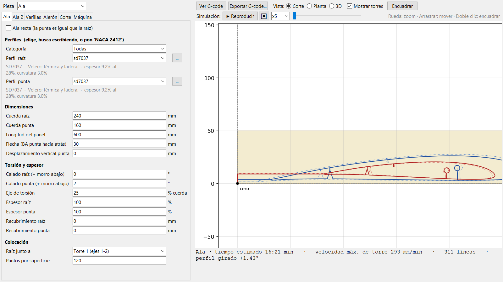
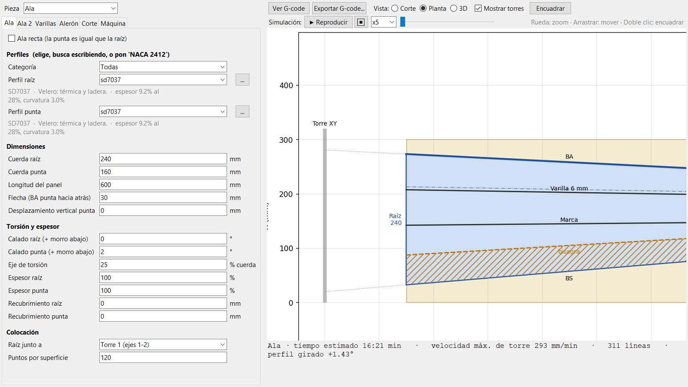
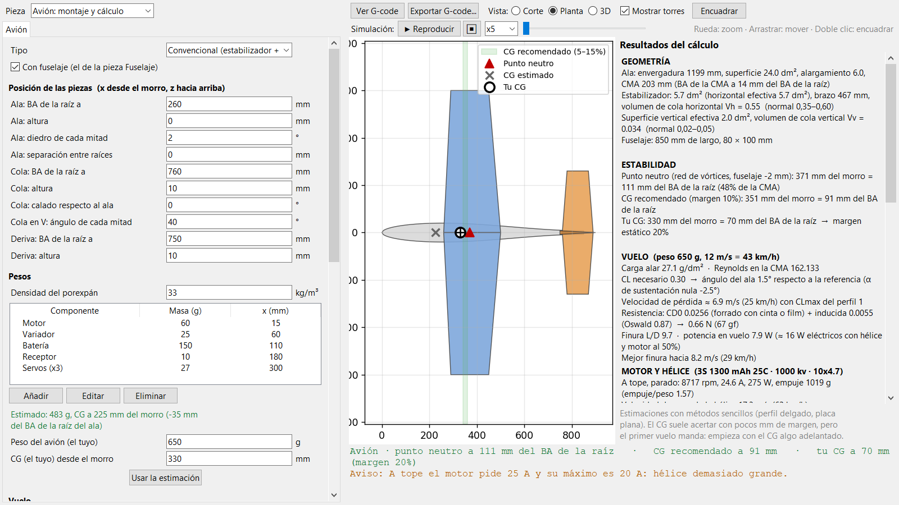
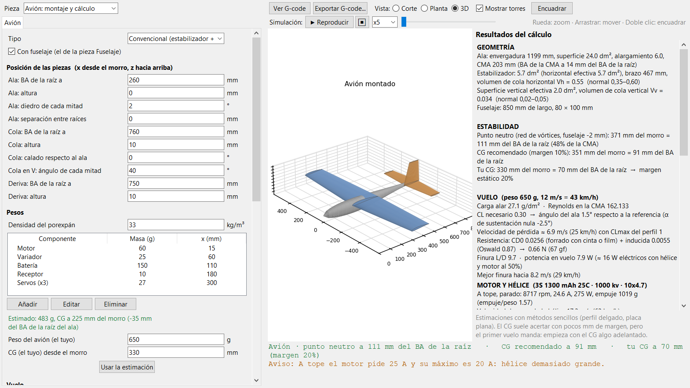
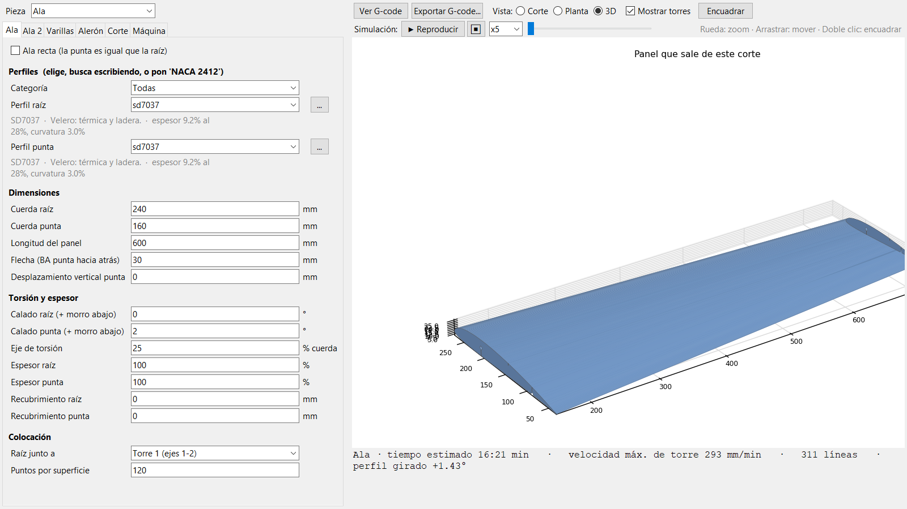
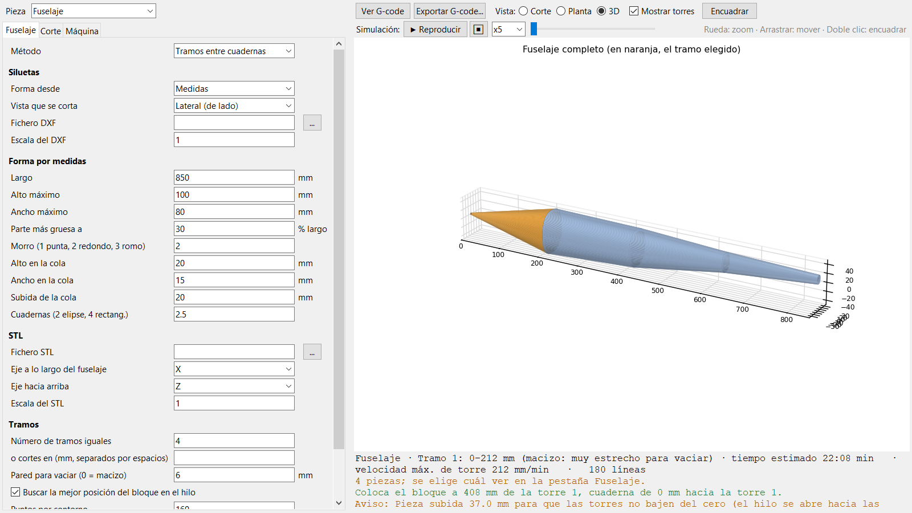

# AeroFoam

Diseño de aeromodelos de corcho y generación de G-code para cortadoras de hilo caliente de 4 ejes
(controladora GRBL, ejes X Y A Z). Alas, cola y fuselaje se diseñan, se comprueban en 2D, en planta y
en 3D, se simula el corte y se exporta el G-code. Incluye un apartado de cálculo del avión completo:
centro de gravedad, estabilidad, mandos, motor y autonomía.

*English summary below.*

## Capturas

| Corte del ala (perfil, varillas, alerón y torres) | Planta del ala en el bloque |
|---|---|
|  |  |
| **Avión: montaje y cálculo** | **Avión montado en 3D** |
|  |  |
| **Panel del ala en 3D** | **Fuselaje por tramos** |
|  |  |

## Funciones

**Alas, estabilizador y deriva**
- Perfil de raíz y de punta (catálogo de 130 perfiles, NACA de 4 dígitos o cualquier `.dat`).
- Cuerdas, envergadura, flecha, torsión, espesor, recubrimiento, ala recta.
- Agujeros y marcas de varillas y ranuras de larguero, con posición distinta en raíz y punta.
- Alerones y timones con bisagra arriba (cuña en V en el mismo corte) y opción de partir el panel en tramos.
- Orientación del perfil en el bloque (apoyado, tramo paralelo, mínimo espesor) y comprobación de dos
  alas en un mismo bloque.

**Fuselajes**
- Siluetas lateral y en planta (por medidas, DXF o STL).
- Tramos entre cuadernas, macizos o huecos, por medidas o a partir de un STL; el programa indica dónde
  colocar el bloque a lo largo del hilo.

**Corte**
- Kerf con compensación independiente en raíz y punta, velocidades de corte, entrada, varillas y
  desplazamiento, F tal cual o corregida para los 4 ejes.
- Materiales con su velocidad, kerf, densidad y acabado (Opciones → Materiales).
- Calibración de velocidad y kerf con un G-code de prueba (Herramientas → Calibrar velocidad y kerf).
- Simulación del corte, vistas de corte, planta y 3D, exportación del modelo a STL.

**Avión: montaje y cálculo**
- Cola convencional, en V o ala volante sin cola; posición de cada pieza; diedro.
- Peso estimado (corcho por volumen y densidad más componentes); el peso y el CG finales los pone el usuario.
- Punto neutro y CG recomendado por red de vórtices propia, con corrección del fuselaje.
- Volúmenes de cola y distancia de la cola, mandos (momento de bisagra frente al servo, alabeo,
  profundidad, dirección).
- Vuelo: pérdida, ángulo, resistencia por fricción de placa plana según el acabado, finura y potencia.
- Motor, batería y hélice: rpm, consumo, empuje, despegue, velocidad máxima y autonomía.

## Instalación

**Con el instalador de Windows**: ejecutar `AeroFoam_Setup_X.Y.exe` (se genera con
`herramientas\crear_instalador.bat`). Se instala para el usuario actual, sin permisos de administrador.

**Desde el código** (Python 3.11 o posterior):

```
pip install -r requirements.txt
python main.py
```

En Windows también se puede abrir con doble clic en `AeroFoam.bat`.

## Uso rápido
1. En **Máquina**, la distancia entre torres, el recorrido, la velocidad máxima y el nombre de los ejes.
2. Elige la **Pieza** arriba a la izquierda (ala, estabilizador, deriva, fuselaje o avión).
3. Ajusta la geometría y, en **Corte**, el material, el bloque, la entrada y la altura.
4. Revisa el corte en las vistas y con la simulación.
5. **Exportar G-code**. El hilo empieza en el cero de trabajo: la esquina inferior del bloque del lado
   del borde de salida.

El G-code es ASCII y usa solo `G1`, `G4`, `G21/G90/G94` (o `G93`) y el encendido del hilo definido en
Máquina (por defecto `M3 S...` / `M5`).

## Pruebas
```
python pruebas/prueba_general.py
```
Comprueba el catálogo de perfiles, el corte de alas con todos los perfiles (sin cruces), el G-code,
los fuselajes, el cálculo del avión, la calibración, el guardado de proyectos y la interfaz.

## Dónde se guardan los datos
- Desde el código: en la propia carpeta (`maquina.json`, `materiales.json`, `proyectos/`).
- Instalado: configuración en `%APPDATA%\AeroFoam`; proyectos y perfiles propios en `Documentos\AeroFoam`.
- Para añadir perfiles basta con copiar ficheros `.dat` en la carpeta de perfiles: aparecen en la
  categoría "Mis perfiles".

## Estructura

| Carpeta / fichero | Contenido |
|---|---|
| `aerofoam/gui.py` | interfaz |
| `aerofoam/proyecto.py` | datos del proyecto y de la máquina |
| `aerofoam/perfiles.py` | lectura de perfiles, spline del contorno, NACA de 4 dígitos |
| `aerofoam/geometria.py` | trayectoria del ala: varillas, alerones, kerf, colocación y torres |
| `aerofoam/corte2d.py`, `fuselaje.py`, `importar.py` | fuselajes, DXF y STL |
| `aerofoam/gcode.py` | generación del G-code |
| `aerofoam/aero.py`, `vlm.py` | cálculo del avión y red de vórtices |
| `aerofoam/calibracion.py`, `materiales.py` | calibración y materiales |
| `aerofoam/planta.py`, `modelo3d.py`, `bloque.py`, `tramos.py` | vistas, 3D, bloque y tramos |
| `perfiles/` | catálogo de perfiles (`catalogo.json` y ficheros `.dat`) |
| `instalador/`, `herramientas/` | instalador de Windows |
| `pruebas/prueba_general.py` | pruebas automáticas |

## Licencia
Todos los derechos reservados. Ver [LICENSE](LICENSE) y [THIRD_PARTY.md](THIRD_PARTY.md).

---

## English summary

**AeroFoam** is a desktop application (Python, tkinter, matplotlib) for designing foam RC aircraft and
generating G-code for 4-axis hot-wire foam cutters driven by GRBL (axes X Y A Z, two independent towers).
The user interface is in Spanish.

- **Wings and tail surfaces**: different root and tip airfoils (built-in catalog of 130 airfoils, NACA
  4-digit or any `.dat` file), taper, sweep, washout, spar/rod holes with independent root and tip
  positions, hinged ailerons cut in the same pass with a V groove, split panels, and placement of the
  airfoil inside the foam block.
- **Fuselages**: side and top silhouettes, or sections between formers (solid or hollow) from simple
  dimensions, DXF or STL.
- **Cutting**: independent kerf compensation at each tower, literal or 4-axis corrected feed rate (or
  G93 inverse time), materials library, a speed/kerf calibration test G-code, cut simulation, 2D, plan
  and 3D views, STL export.
- **Aircraft analysis**: assembly of wing, tail and fuselage; neutral point and recommended CG from an
  in-house vortex lattice solver with fuselage correction; tail volumes, control surface hinge moments,
  stall speed, drag, glide ratio, and motor/battery/propeller performance and flight time.
- **Quality**: automated test suite (`python pruebas/prueba_general.py`) covering the airfoil catalog,
  self-intersection checks of every cut path, G-code format, fuselages, aircraft analysis, calibration,
  project save/load and the GUI. Windows installer built with PyInstaller and Inno Setup.

Run from source with Python 3.11+: `pip install -r requirements.txt` and `python main.py`.
